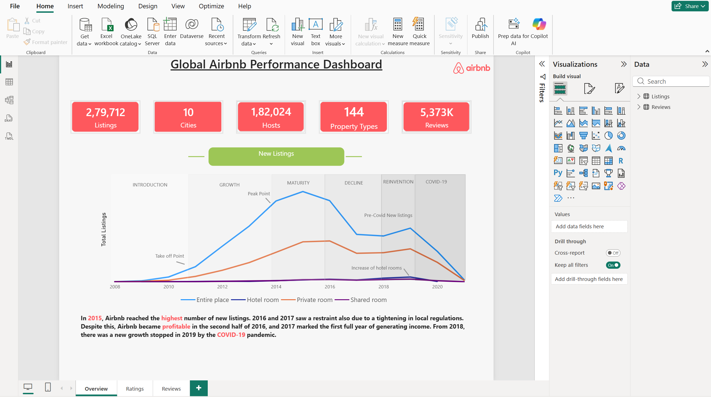
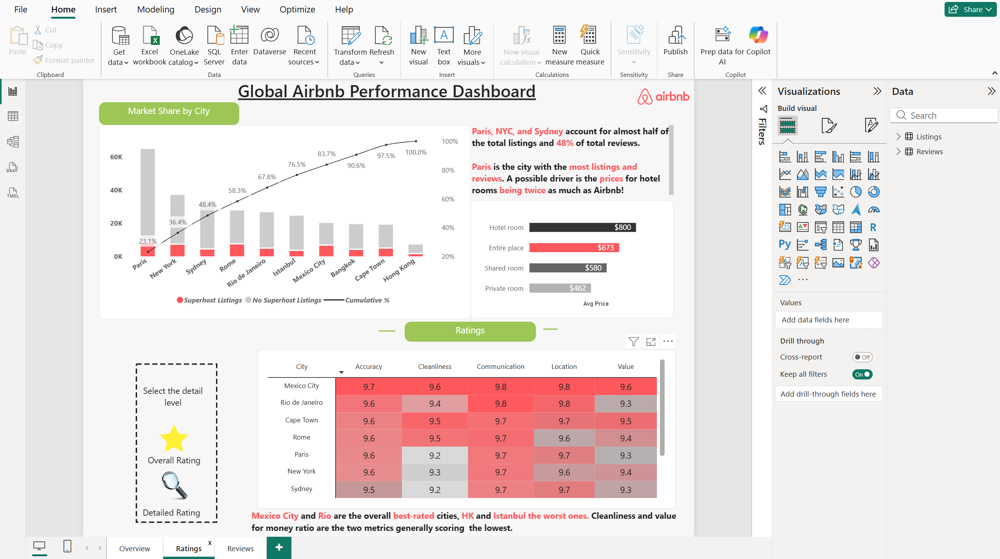
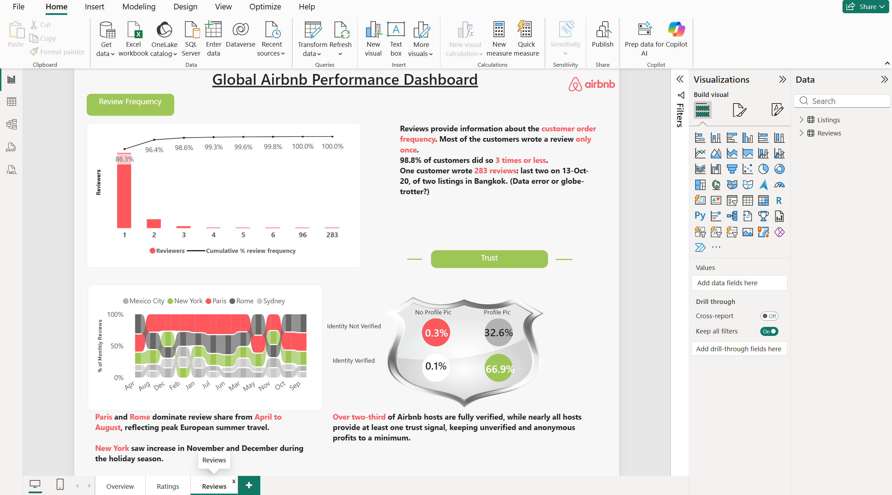

# Global Airbnb Performance Dashboard

An interactive **Power BI** dashboard analysing Airbnb listings, hosts, ratings and reviews across 10 major cities worldwide. It covers market growth over time, city market share, guest ratings, reviewer behaviour and host trust signals.



---

## Key Figures

| Metric | Value |
|---|---|
| Listings | 279,712 |
| Cities | 10 |
| Hosts | 182,024 |
| Property types | 144 |
| Reviews | 5.37 million |

Cities covered: Paris, New York, Sydney, Rome, Rio de Janeiro, Istanbul, Mexico City, Bangkok, Cape Town, Hong Kong.

---

## Dashboard Pages

### 1. Overview: Airbnb's growth story


- KPI cards for listings, cities, hosts, property types and reviews.
- Line chart of new listings by host-joined year and room type, annotated with the stages of the business lifecycle: **Introduction, Growth, Maturity, Decline, Reinvention and COVID-19**.

**Insight:** New listings peaked in **2015**. 2016 and 2017 saw a slowdown linked to tighter local regulations, followed by renewed growth from 2018 that was halted by the COVID-19 pandemic. Entire places and private rooms drive almost all of the volume.

### 2. Ratings: Market share and guest satisfaction


- **Pareto chart** of listings by city, split into superhost and non-superhost listings, with a cumulative % line.
- Average price by room type.
- Ratings matrix (Accuracy, Cleanliness, Communication, Location, Value) by city with colour scale, plus a bookmark toggle between *Overall* and *Detailed* rating views.

**Insights**
- Paris, New York and Sydney account for almost half of all listings (48.4% cumulative) and 48% of reviews.
- Paris has the most listings and reviews.
- Hotel rooms have the highest average price ($800), ahead of entire places ($673), shared rooms ($580) and private rooms ($462).
- Mexico City and Rio de Janeiro are the best-rated cities. Hong Kong and Istanbul score lowest. Cleanliness and value for money are generally the lowest-scoring metrics.

### 3. Reviews: Reviewer behaviour and trust


- **Review frequency** combo chart: number of reviewers by reviews written, with a cumulative % line.
- **Seasonality** ribbon chart: share of monthly reviews by city.
- **Trust shield:** host identity verification vs. profile picture.

**Insights**
- 86.3% of reviewers wrote only one review, and 98.8% wrote three or fewer.
- One reviewer wrote 283 reviews, which could be a data error or a genuine globe-trotter.
- Paris and Rome dominate review share from April to August, reflecting peak European summer travel. New York rises in November and December.
- 66.9% of hosts are verified with a profile picture. Only 0.3% are unverified with no profile picture, and 0.1% are verified without one.

---

## Data Model

Two related tables:

| Table | Description |
|---|---|
| `Listings` | One row per listing: city, room type, property type, price, host details (superhost, identity verified, profile picture, host since) and review scores |
| `Reviews` | One row per review: `review_id`, `listing_id`, `reviewer_id`, date |

Relationship: `Listings[listing_id]` to `Reviews[listing_id]`.

---

## Key DAX

**Reviewers** (unique reviewers in the current filter context)
```dax
Reviewers = 
DISTINCTCOUNT( Reviews[reviewer_id] )
```

**Reviews per Reviewer** (calculated column in `Reviews`)
```dax
Reviews per Reviewer = 
CALCULATE(
    COUNT( Reviews[review_id] ),
    ALLEXCEPT( Reviews, Reviews[reviewer_id] )
)
```

**Cumulative Reviewers** (reviewers who wrote N reviews or fewer)
```dax
Cumulative Reviewers = 
VAR CurrentReviews = 
    MAX( Reviews[Reviews per Reviewer] )
RETURN
CALCULATE(
    DISTINCTCOUNT( Reviews[reviewer_id] ),
    FILTER(
        ALL( Reviews[Reviews per Reviewer] ),
        Reviews[Reviews per Reviewer] <= CurrentReviews
    )
)
```

**Show in Review Frequency Chart** (keeps the X-axis to 1 to 6 reviews plus heavy reviewers)
```dax
Show in Review Frequency Chart = 
IF(
    Reviews[Reviews per Reviewer] <= 6
        || Reviews[Reviews per Reviewer] > 85,
    1,
    0
)
```

**% of Total Reviewers**
```dax
% of Total Reviewers = 
DIVIDE(
    DISTINCTCOUNT( Reviews[reviewer_id] ),
    CALCULATE( DISTINCTCOUNT( Reviews[reviewer_id] ), ALL( Reviews ) )
)
```

**% of Monthly Reviews** (city share of reviews within the selected cities)
```dax
% of Monthly Reviews = 
DIVIDE(
    [Total Reviews],
    CALCULATE(
        [Total Reviews],
        ALLSELECTED( Listings[city] )
    )
)
```

**Rating metric** (one measure per score: Accuracy, Cleanliness, Communication, Location, Value)
```dax
Value = 
AVERAGE( Listings[review_scores_value] )
```

Other measures: `Superhost Listings`, `No Superhost Listings`, `Cumulative %` (Pareto line), `Avg Price`, `Avg Rating`, and the host trust percentages (`Verified_Profile %`, `Verified_NoProfile %`, `NotVerified_Profile %`, `NotVerified_NoProfile %`).

---

## Techniques Used

- Combo charts with a secondary axis (Pareto and review frequency)
- Cumulative distribution measures using `CALCULATE`, `FILTER` and `ALL`
- A calculated column plus visual-level filter to focus the X-axis
- Ribbon chart for seasonality
- Bookmarks and buttons for switching between Overall and Detailed ratings
- Conditional formatting (colour scales) in the ratings matrix
- Custom layout, Airbnb colour theme and annotated insights

---

## Tools

- Power BI Desktop
- DAX

---

## Data Source

> Add your source here, for example: *Inside Airbnb* or the Kaggle dataset you used, with a link.

---

## How to Use

1. Download `Airbnb Dashboard.pbix` from this repository (if included).
2. Open it in Power BI Desktop.
3. Use the page tabs at the bottom (Overview, Ratings, Reviews) and the buttons on each page to explore.

---

## Author

Tanmay Wadekar

